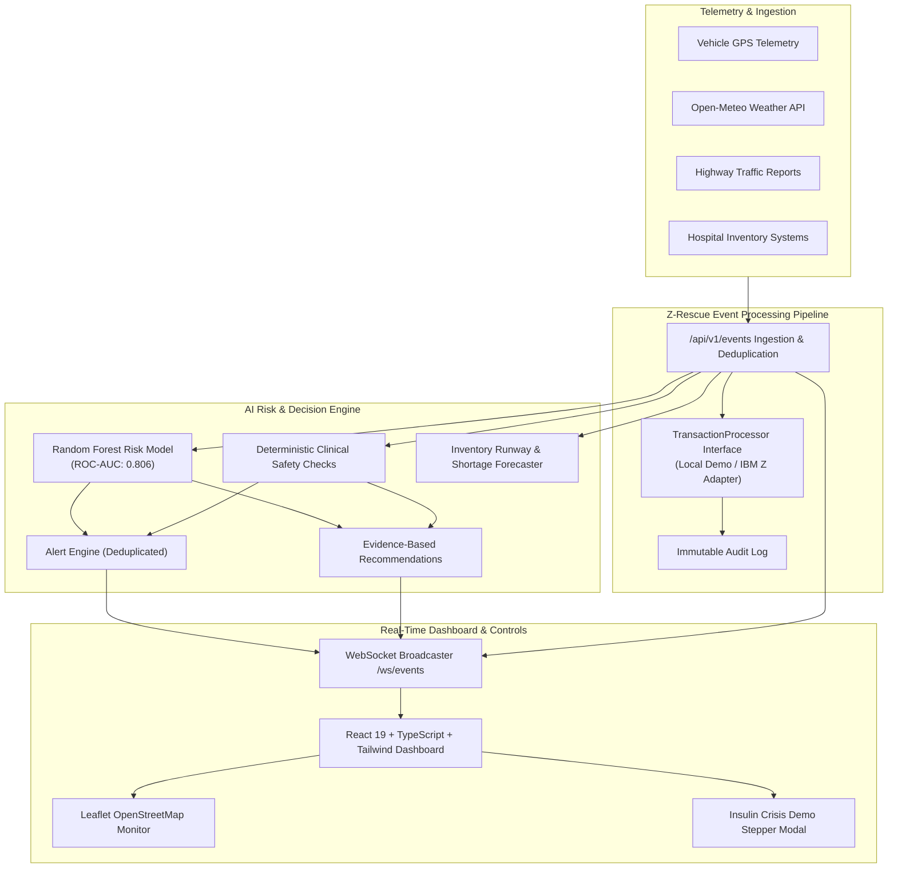

# Z-Rescue — Real-Time AI for Critical Decisions
### IBM Z Datathon 2026 | Team: UNI MIND | Event Code: SSF2026
**Tagline:** *Predict Early. Respond Faster. Protect Essential Supplies.*

---

## 1. Project Overview

Disruptions caused by severe weather, flash flooding, highway blockages, and sudden hospital ICU surges can interrupt deliveries of life-saving medical supplies (such as insulin, emergency epinephrine, critical antibiotics, and blood products). 

**Z-Rescue** continuously evaluates changing weather, road, shipment, and inventory events to estimate delivery disruption risks in real time. It detects anomalies, predicts potential stockouts, alerts logistics coordinators, and recommends prioritized, human-authorized interventions hours before a crisis impacts clinical care.

> **Responsible AI Notice:** Z-Rescue is an operational decision-support prototype built for the IBM Z Datathon 2026. It is not a clinically validated prescribing device and does not autonomously dispatch vehicles or alter physician orders.

---

## 2. System Architecture



---

## 3. Technology Stack

- **Frontend:** React 19, TypeScript, Vite 8, Tailwind CSS v4, Lucide React, Leaflet & OpenStreetMap, Native SVG Visualizations.
- **Backend:** Python 3.13, FastAPI, Pydantic v2, SQLAlchemy 2.0, SQLite with ACID-guaranteed pragmas, WebSockets.
- **AI / ML:** scikit-learn (RandomForestClassifier, ROC-AUC 0.806), pandas, NumPy, deterministic clinical rule checks.
- **Integrations:** Open-Meteo Weather API with offline caching, `IBMZTransactionProcessor` enterprise adapter.

---

## 4. Key Implemented Features

1. **Operational Overview Dashboard**: 6 live aggregate KPI metrics, risk categorization donut chart, status breakdown bar chart, and urgent intervention tables.
2. **Real-Time Event Ingestion Pipeline**: REST endpoint `/api/v1/events`, deduplication protection, correlation IDs, and WebSocket broadcasting.
3. **Medicine Shipment Management**: Full CRUD, search, status/risk filters, thermal cold-chain monitoring, and drill-down detail views.
4. **AI-Powered Risk Engine**: scikit-learn classification model returning 0–100 risk score, risk tier (Low, Moderate, High, Critical), and explainable contributing factors.
5. **Early Warning & Alert Center**: Automated threshold triggers, duplicate suppression, and Acknowledge/Resolve workflows.
6. **Recommendation Engine**: Actionable decision-support cards with supporting evidence and mandatory human approval.
7. **Hospital Inventory & Shortage Forecaster**: On-hand stock vs safety reserves, hourly burn rates, and shortage gap warnings.
8. **Live Route & Weather Monitor**: Interactive Leaflet map with corridor waypoints and community road hazard submission form.
9. **Immutable Audit Trail**: Cryptographically correlated compliance log of all transactions and coordinator actions.
10. **Interactive Demonstration Scenario**: Step-by-step presentation mode featuring cold-chain insulin shipment `SHP-801`.
11. **IBM Z Transaction Layer**: Clean `TransactionProcessor` abstraction with `LocalDemoTransactionProcessor` and `IBMZTransactionProcessor` enterprise adapter.

---

## 5. Local Setup & Execution Instructions (Windows)

### Prerequisites
- Python 3.11+ (tested on Python 3.13)
- Node.js 18+ and npm

### Step 1: Clone Repository
```bash
git clone https://github.com/gitdevelopers007/Z-Rescue.git
cd Z-Rescue
```

### Step 2: Initialize Database and Seed Baseline Data
```bash
python -m backend.app.seed_data
```

### Step 3: Train the Risk Model (Optional, pre-trained model included)
```bash
python backend/app/ai/train_model.py
```

### Step 4: Run the Backend Server
```bash
python backend/run_server.py
```
*Backend API online at: `http://127.0.0.1:8000`*
*Interactive OpenAPI Swagger documentation: `http://127.0.0.1:8000/docs`*

### Step 5: Run the Frontend Application
In a separate terminal:
```bash
cd frontend
npm run dev
```
*Frontend dashboard online at: `http://localhost:5173`*

---

## 6. Running Automated Tests

Run the comprehensive 25-scenario backend test suite:
```bash
python backend/run_tests.py
```

**Results:**
```text
======================================================================
Total Tests Run: 25
Passed: 25
Failures: 0
Errors: 0
>>> ALL 25 BACKEND TESTS PASSED SUCCESSFULLY! <<<
======================================================================
```

---

## 7. IBM Z Integration Architecture & Transparency

In compliance with Datathon standards:
- The system runs by default in **Demo Mode** via the high-throughput `LocalDemoTransactionProcessor`.
- The UI displays: **"Local Demo Processor — IBM Z integration adapter ready"**.
- The `IBMZTransactionProcessor` adapter implements standard enterprise contracts:
  - Correlation IDs (`Z-RESCUE-TX-...`)
  - Idempotency key headers
  - Configurable timeouts and retries
  - Sub-millisecond latency logging
- See [docs/IBM_Z_INTEGRATION.md](docs/IBM_Z_INTEGRATION.md) for full architectural details regarding IBM LinuxONE and IBM Machine Learning for z/OS (IMLz).

---

## 8. Team & Submission Details

- **Project:** Z-Rescue
- **Team Name:** UNI MIND
- **Event:** IBM Z Datathon 2026
- **Event Code:** SSF2026
- **Official Theme:** Real-Time AI for Critical Decisions
